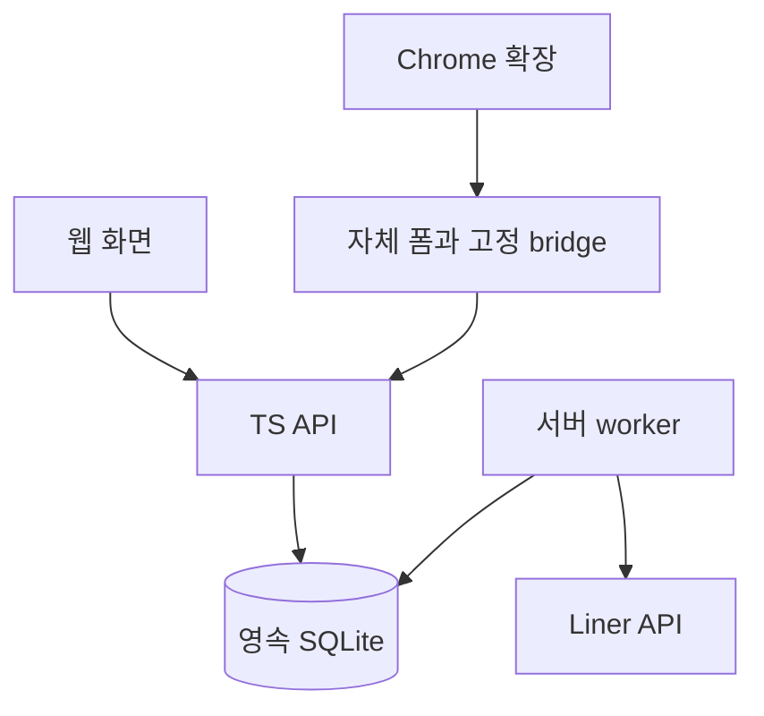
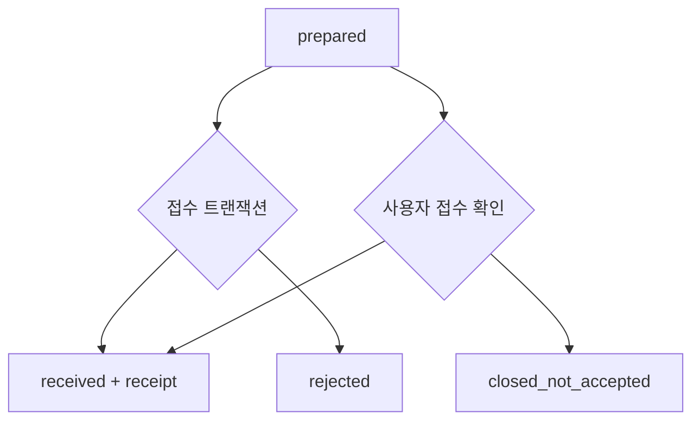

# Career Evidence 데이터 모델·API 명세 v0.4

기준: 팀 기획서 v0.2 · UI·UX 상세 설계 v0.3 · 작성일: 2026.11.15 (한국 시간)

## 01. 범위와 이번 단계의 결정

이 문서는 구현에 넘길 계약입니다. 실행 가능한 웹 서비스나 Chrome 확장 프로그램을 완성했다는 뜻은 아닙니다. 공식 provider 계약, 제품이 정한 동작, 아직 검증하지 않은 통합을 구분합니다.

### 고정한 제품 범위

| 구분 | 이번 계약 |
| --- | --- |
| 사용자·자료 | 합성 프로필·합성 PDF, 공개 공고·기업 자료. 대화 시안의 가상 결과와 실제 조사 결과를 구분 |
| 공고 탐색 | 검색 1회당 중복 제거 후 후보 최대 10개. 0개·2개이면 실제 개수 유지 |
| 공고 분석 | 요청 1회당 같은 검색의 서로 다른 공고 1~3개 |
| 기업 조사 | 검색 회차 1개에서 회사 1곳을 예약. 같은 회사의 재시도 가능 |
| 브라우저 지원 | PC Chrome, 자체 테스트 폼 1종. 11/18 핵심 흐름 완주 시 착수 |
| 기반 구성 | React·TypeScript 웹 + 영속 디스크를 가진 TS 서비스·worker + SQLite |

### 핵심 계약

- 프로필·조건·공고·근거·지원 답변의 버전을 고정합니다. 늦게 도착한 작업이 최신 화면의 다른 회사를 덮어쓰지 않습니다.
- Liner는 검색·조사 provider이고, 우리 서버가 작업 ID·조회·재시도·비용 상태를 관리합니다.
- 사용자 확인은 회사·직무·대상 폼·답변·첨부 바이트·동의와 연결됩니다. 수정 후 이전 확인은 사용할 수 없습니다.
- 테스트 폼은 동일 DB의 트랜잭션과 고유 제약으로 지원 건당 접수 기록을 최대 1개 만듭니다.
- 접수 확인 필요는 클라이언트의 관측 상태입니다. 서버의 실제 접수 상태를 unknown으로 덮어쓰지 않습니다.

### 파일의 역할

`openapi.yaml`은 HTTP 계약, `schemas/domain.schema.json`은 공개 데이터 형식, `schema.sql`은 DB 제약 후보입니다. 서비스 계층의 소유권·정규화·상태 전이 검증까지 SQL만으로 완성되지는 않습니다. `DECISIONS.md`에 결정과 보류 사항을 남겼습니다.

<!-- page -->

## 02. 실행 구조와 책임

웹·테스트 폼·API는 같은 origin에 둡니다. Liner 호출은 서버 worker가 맡습니다. 확장은 자체 폼의 정해진 동작만 요청하며, 페이지가 세션·CSRF를 붙여 고정 API를 호출합니다.

| 구성 | 책임 |
| --- | --- |
| 웹 | 프로필·조건 적용, 공고 비교, 근거 표시, 브리프, 초안·기록 조회 |
| TS API | 세션 범위, CAS, 입력 검증, 작업 예약, 승인·시도·접수 트랜잭션 |
| worker | 저장된 작업 claim, Liner SSE 수신, 결과 정규화, lease 기반 결과 저장 |
| SQLite | 불변 스냅샷, 작업·호출 이력, 승인·접수의 권위 상태 |
| 확장 | 허용 탭·document 확인, 고정 필드 입력·readback, 사용자 확인 흐름 |
| 자체 폼 | 실제 FormData와 PDF 바이트 전송, 고정 endpoint 호출, 결과 표시 |

### 배포 전제

초기 개발·시연은 로컬 또는 단일 영속 서버에서 수행합니다. 서버와 worker가 같은 SQLite 파일을 사용하고, 파일은 재시작 후에도 보존되어야 합니다. 임시 디스크만 있는 배포 환경에 이 구조를 그대로 올리지 않습니다. 별도 Redis·분산 큐는 이번 범위의 필수 요소가 아닙니다.

<!-- page -->

## 03. 데이터 모델 - 탐색과 조사

관계·소유권·버전·작업 상태는 열로, 가변 길이 문항·출처·주장은 검증된 JSON으로 보관합니다. 공개 API는 snake_case와 UTC RFC3339 시각, DB 시각은 정수 epoch milliseconds를 사용합니다.

| 테이블 | 핵심 정보와 불변조건 |
| --- | --- |
| workspaces | 합성 데이터 작업 범위. 세션·CSRF의 hash, revision, 현재 context. 클라이언트가 보낸 workspace_id를 인가 근거로 사용하지 않음 |
| context_revisions | 선택 프로필 ID·버전·내용과 적용 조건의 불변 묶음. 조건 변경마다 새 행 |
| tasks | 종류, 고정 입력, 상태, 실제 진행 수, lease 소유자·만료·세대, 결과·오류 |
| provider_calls | provider 호출별 reserved/dispatched/succeeded/failed/unknown, 추적 ID·비용 추정. task 재시도와 구분 |
| search_runs | 검색 시 context, 질의, 작업 연결, 처음 선택한 심층 조사 company_key |
| job_candidates | 검색 안의 slot 1~10, 정규화한 job_key, 회사·직무·URL·수집 시점의 스냅샷 |
| fact_bundles | 공고별 출처·주장 묶음. 조건과 독립된 불변 조사 결과 |
| assessments | context + fact bundle + match.v1 규칙에 따른 판단. 재평가는 새 행 |

### 중요한 관계

같은 workspace의 검색·후보·context·fact bundle만 연결합니다. 복합 FK는 workspace와 해당 candidate를 함께 묶습니다. JSON 안의 source_id·experience_id 참조는 해당 스냅샷 내부에 존재하는지 서비스에서 추가 검사합니다.

### 공고 식별

job_key는 서버가 정규화한 원문 URL에서 계산합니다. fragment·추적 파라미터는 제거하되 공고 ID를 담은 query는 보존합니다. 회사명이나 LLM이 만든 이름만으로 동일 공고를 판정하지 않습니다. 서로 다른 URL의 동일 공고를 완벽히 합치는 보장은 이번 범위에 포함하지 않습니다.

<!-- page -->

## 04. 데이터 모델 - 지원과 접수

편집 중인 초안과 최종 확인한 제출본을 분리합니다. 이전에 제출한 내용을 현재 초안으로 대체하지 않습니다.

| 테이블 | 핵심 정보와 불변조건 |
| --- | --- |
| brief_snapshots | candidate·context·assessment·작업과 결속된 불변 브리프. 원문·질문·출처·확인 시각 |
| files | 서버에 등록한 합성 PDF. 불변 객체 참조, 파일명·MIME·실제 bytes SHA-256·크기 |
| applications | 지원 건의 현재 revision. workspace + job_key + target_id 고유 |
| application_revisions | 문항·입사 시점·첨부 참조·동의의 불변 초안 버전. CAS로 head 전진 |
| form_sessions | 해당 application에 허용한 정확한 origin·경로·폼 버전·만료 |
| approvals | revision·form session·전체 승인 payload·digest. 본문은 불변, consumed/revoked만 변화 |
| submission_attempts | 전송 전에 저장한 시도. prepared/received/rejected/closed_not_accepted |
| test_receipts | 성공 접수만. application당 1개, attempt당 1개. 변경·삭제 금지 |
| request_keys | workspace + operation + Idempotency-Key + 요청 hash + 생성 결과 |

### DB와 서비스의 경계

DB는 교차 workspace/app 참조, 후보 슬롯 초과, 중복 접수, 불변 행 수정 등을 막습니다. 서버는 로그인 세션의 소유권, 만료, exact Origin, CSRF, JSON 내부 관계, 실제 파일 hash, JCS digest와 입력 길이를 확인합니다. 두 층을 함께 적용합니다.

### 보존과 재시도

접수 거절은 attempt의 종료 결과로 보존합니다. receipt는 성공에만 생성합니다. 거절 또는 이전 시도 종료 후 수정하려면 새 revision·새 승인·새 attempt가 필요합니다. received인 application은 이번 MVP에서 다시 제출하지 않습니다.

<!-- page -->

## 05. 근거와 판단의 데이터 계약

출처가 있다는 사실과 그 출처가 특정 주장을 뒷받침한다는 사실을 구분합니다. 검색 스니펫은 공고 원문 전체나 모집 상태 확인으로 취급하지 않습니다.[1]

| 데이터 | 필수 의미 |
| --- | --- |
| Source | source_id, URL, 제목(없으면 null), 수집 시각, 자료 유형, 수집 방식, 인용 가능한 일부 원문 |
| Claim | field, known/unknown/conflicting, 값 또는 null, 미확인 이유, 연결된 source_id와 quote |
| ConditionEvaluation | 조건·필수/선호, satisfied/gap/unknown/conflict, 판단 이유, claim·경력 ID |
| Assessment | review/needs_information/hold, context·fact bundle ID, 규칙 버전, 생성 시각 |

### 판단 규칙 match.v1

1. 필수 조건에 명시적인 gap이 하나라도 있으면 hold입니다.
2. 필수 조건에 gap이 없고 unknown 또는 conflict가 있으면 needs_information입니다.
3. 나머지는 review입니다. 선호 조건의 차이·미확인은 이유와 질문으로 남깁니다.
4. 프로필 미기재는 경험 없음으로 바꾸지 않습니다. 합격 확률이나 개인 가치 점수를 만들지 않습니다.

| 원격 필수 예시 | 사실 | 판단 |
| --- | --- | --- |
| 주 4일 원격 명시 | known | 다른 필수 조건도 확인되면 지원 검토 |
| 수집 자료에 원격 언급 없음 | unknown + not_found_in_retrieved_material | 추가 확인 |
| 주 5일 출근 명시 | known + 조건 차이 | 보류 |
| 자료별 안내 상충 | conflicting + 양쪽 인용 | 추가 확인 |

### 정규화 실패

Agent에 원하는 JSON 형식을 요청하더라도 구조화 출력 보장은 공개 계약에서 확인하지 못했습니다.[2][3] 필드·인용 연결 검증이 실패하면 partial/unstructured로 남기고 해당 조건은 unknown으로 처리합니다. 자동 JSON 복구를 위한 추가 유료 모델 호출은 기본 흐름에 넣지 않습니다. 원문 연결 검사는 의미의 진실성을 자동 증명하지 않습니다.

<!-- page -->

## 06. 실제 Liner 계약과 제품 어댑터

공식 문서 확인일은 2026.11.15입니다. 아래 경로는 provider 경로이며, 제품의 /api/v1/tasks와 구분합니다. 실제 키를 사용한 호출은 이번 작업에서 수행하지 않았습니다.

| 역할 | 공식 provider 경로·요청 |
| --- | --- |
| 공개 공고 탐색 | POST https://platform.liner.com/api/v1/tools/search/web · query, country_code=kr, lang=ko, max_results=10, include_knowledge=false [1] |
| 선택 공고 조사 | POST https://platform.liner.com/api/v1/agents/search · messages, lang=ko, mode=general, stream=true, request_id [2] |
| 기업 1곳 조사 | POST https://platform.liner.com/api/v1/agents/deep-research · messages, lang=ko, stream=true, request_id [3] |

### 인증과 응답

서버에서 x-api-key를 사용합니다. Agent messages는 user/assistant 역할이며 마지막 항목은 user입니다. Agent 기본 응답은 SSE, stream=false는 끝날 때까지 기다린 뒤 JSON을 받는 방식입니다.[2][3] 별도 provider job을 생성한 뒤 GET으로 조회하는 계약으로 해석하지 않습니다.

### 성공 판정

HTTP 200과 [DONE]만으로 성공을 판정하지 않습니다. data-error를 먼저 확인하고, 정상 종료·본문·출처 및 자체 스키마 검증 결과를 함께 기록합니다.[2] 출처 날짜는 게시일일 수 있으므로 우리 서버의 retrieved_at과 분리합니다.

### 공개 계약에서 미확인인 항목

세 대상 API의 독립 작업 조회·취소 확인·스트림 재개·중복 실행 방지 보장, Agent JSON Schema 강제 출력은 확인하지 못했습니다. request_id는 추적용 값으로 사용합니다. reasoning-* 원문을 제품의 진행 메시지로 노출하지 않고, 검색 중·근거 정리 중 같은 작업 단계만 표시합니다.

<!-- page -->

## 07. 비동기 작업과 재시작 복구

제품 API는 먼저 task를 저장한 뒤 202와 task_id를 반환합니다. 브라우저는 GET /api/v1/tasks/{id}로 서버에 저장된 진행 상태를 조회합니다. UI 연결이 끊겨도 worker의 작업을 취소하지 않습니다.

| 단계 | 구현 계약 |
| --- | --- |
| 예약 | task·작업 입력·request_key를 짧은 TX에 저장한 뒤 응답 |
| claim | worker가 queued task를 CAS로 running 전환, lease owner·generation·만료 기록 |
| 호출 전 | provider_call을 reserved로 저장, 비용 예약. 네트워크 전송 전 dispatched로 바꿈 |
| 실행 | DB TX 밖에서 Liner 요청·SSE 파싱. heartbeat로 lease 갱신 |
| 결과 저장 | task ID·owner·generation이 현재 lease와 일치할 때만 결과·진행 수 저장 |
| 늦은 결과 | 이전 세대 worker의 응답은 현재 결과를 덮어쓰지 못함 |
| 재시작 | 미전송 예약은 재개 가능. dispatched 후 결과 불명은 unknown 호출로 보존하고 자동 유료 재호출 금지 |

### 작업 상태

queued → running → succeeded/failed/canceled를 사용합니다. 부분 성공은 succeeded + outcome=partial 및 항목별 실패로 표현합니다. 단순 자료 부족은 작업 실패가 아닙니다. 진행 수는 total/settled/succeeded/failed를 저장하고, 근거 없는 퍼센트를 표시하지 않습니다.

### 재시도와 중단

명시적 retryable 오류는 Retry-After와 백오프를 적용할 수 있지만, 이번 MVP는 자동 유료 재시도를 기본 OFF로 둡니다.[4] 사용자가 재시도하면 같은 context와 실패한 후보만 새 task에 연결합니다. 전송 여부·과금이 불확실하면 중복 비용 가능성을 알립니다.

중단 요청은 로컬 후속 처리를 멈추는 계약입니다. 연결을 끊어도 provider 실행·과금이 취소됐다고 확정하지 않습니다. task polling은 기본 2초, 서버 응답의 next_poll_after_ms를 따르고 화면이 숨겨지면 줄입니다.

<!-- page -->

## 08. 핵심 HTTP API

전체 요청·응답은 openapi.yaml과 JSON Schema에 정의했습니다. 경로의 모든 리소스는 현재 세션의 workspace 소유권을 검사합니다.

| 메서드·경로 | 동작·응답 |
| --- | --- |
| POST /api/v1/demo/session | 합성 데모 세션 시작. 기존 유효 세션 재사용 |
| GET /api/v1/session · /profiles | 현재 상태·웹 전용 CSRF / 합성 프로필 목록 |
| POST /api/v1/contexts | expected_workspace_revision CAS, 불변 프로필·조건 적용. 유료 호출 0 |
| GET /api/v1/contexts/{id} | 특정 적용 버전 조회 |
| POST /api/v1/searches | context 고정, task + search 생성. 202 |
| GET /api/v1/searches/{id} | 실제 후보 수·후보·선택 조사 회사 조회 |
| POST /api/v1/analyses | 같은 검색 후보 1~3개 분석. 202 |
| POST /api/v1/re-evaluations | fact bundle 1~3개를 새 context로 평가. provider_calls=0 |
| GET /api/v1/assessments/{id} | 판단과 조건별 이유 조회 |
| GET /api/v1/fact-bundles/{id} | 출처·주장·상충·수집 시점 조회 |
| POST /api/v1/briefs | search의 회사 슬롯 예약, 기업 조사 task. 202 |
| GET /api/v1/briefs/{id}[/download] | 고정 브리프 버전 조회/동일 내용 PDF·Markdown 내려받기 |
| GET /api/v1/tasks/{id} | 상태·진행·결과·재시도/비용 불확실성 조회 |
| POST /api/v1/tasks/{id}/cancel 또는 /retry | 로컬 처리 중단 요청 / 실패 항목의 명시적 새 작업 |

### 검색·조사의 ID

TaskAccepted의 resource_id는 검색의 search_id, 분석의 task_id, 브리프의 예약된 brief_id입니다. 브리프 생성 전에는 task 결과를 기다립니다. 재시도는 기존 검색 범위·선택 회사를 유지하며, 성공한 후보·브리프를 덮어쓰지 않습니다. 같은 candidate의 기업 조사가 이미 성공했다면 새 context의 브리프는 기존 기업 facts로 조립하고, 자료의 원래 확인 시각을 유지합니다.

<!-- page -->

## 09. 지원·접수 HTTP API

browser_apply 기능이 ON인 빌드에서 사용합니다. 서버가 정한 테스트 대상 외의 origin·경로·파일을 입력으로 받아 실행하지 않습니다.

| 메서드·경로 | 동작·응답 |
| --- | --- |
| GET /api/v1/files | 서버에 등록한 합성 PDF 목록·bytes hash |
| GET /api/v1/files/{id}/content | 해당 합성 PDF의 실제 바이트 |
| POST /api/v1/applications | candidate·context·brief 결속 검증. 같은 job_key+target이면 기존 app 반환 |
| GET /api/v1/applications/{id} | 현재 revision, 활성 시도, 접수·잠금 상태 |
| PATCH /api/v1/applications/{id} | expected_revision CAS. 전체 content 저장·승인 철회 |
| GET /api/v1/application-records | 시도별 상태와 당시 제출본. cursor 기반 최대 50개 |
| POST /api/v1/applications/{id}/form-sessions | 허용된 폼 인스턴스 연결. 새 연결에서 이전 승인 재사용 금지 |
| POST /api/v1/applications/{id}/approvals | revision+폼+readback+사용자 확인을 검증하고 승인 snapshot 생성 |
| POST /api/v1/applications/{id}/attempts | 승인 소비 + prepared 시도 영속 예약. 실제 전송 전 실행 |
| POST /demo/v1/submissions | payload JSON + 실제 PDF multipart. 서버에서 바이트·현재값 재검증 |
| GET /api/v1/attempts/{id} | 읽기 전용 접수·거절·당시 payload 조회 |
| POST /api/v1/attempts/{id}/reconcile | receipt 반환 또는 이전 시도 영구 종료. 사용자 확인 동작에서만 실행 |

### 편집과 제출 잠금

prepared인 시도가 있거나 received인 지원 건은 초안 수정·다른 시도 생성을 거절합니다. 전송 불확실성은 조회 또는 명시적 reconcile로 해결합니다. draft 수정은 답변의 사용자 수정 표시를 서버가 강제하며, 클라이언트가 경력 확인 상태를 임의로 승격할 수 없습니다.

<!-- page -->

## 10. 공통 요청·응답·중복 방지

변경 API는 정확한 Origin, 세션, X-CSRF-Token을 검사합니다. 생성·수정·작업 제어 요청은 Idempotency-Key를 사용합니다. 초기 세션 시작과 최종 multipart는 별도 규칙을 적용합니다.

| 규칙 | 계약 |
| --- | --- |
| 키 범위 | workspace + operationId + Idempotency-Key. 키는 UUID, 전송 전에 로컬 포인터로 보존 |
| 요청 fingerprint | method + LF + 대상 ID를 포함한 정규화 path + LF + JCS(body)의 UTF-8 SHA-256 |
| 같은 키·같은 요청 | 이미 만든 같은 리소스의 현재 상태 반환. 새 task/approval/attempt 생성 금지 |
| 같은 키·다른 대상/본문 | 409 IDEMPOTENCY_KEY_REUSED. 다른 task의 cancel 요청에도 기존 결과 재생 금지 |
| 저장 순서 | 리소스와 request_key를 같은 TX에서 기록. 응답 유실 후 같은 키로 회수 |
| 현재 권한 | replay라도 현재 세션·scope를 다시 검사. 키는 인가 수단이 아님 |
| 키 보존 | workspace 수명 동안 보존. 같은 키가 만료 후 조용히 새 작업이 되지 않게 함 |
| CAS | expected_revision 불일치면 409 REVISION_CONFLICT. 최신 내용과 충돌 이유 제공 |
| 최종 접수 | attempt_id가 효과 중복 방지 키. 같은 내용 replay만 같은 receipt, 다른 내용은 409 |

### 대표 오류

| 코드 | UI 동작 |
| --- | --- |
| REVISION_CONFLICT | 최신 초안 불러오기·사용자 변경 보존, 자동 덮어쓰기 금지 |
| READBACK_MISMATCH | 달라진 필드를 표시하고 다시 읽기·수정 |
| APPLICATION_LOCKED / ACTIVE_ATTEMPT_EXISTS | 기존 시도 조회 |
| APPROVAL_EXPIRED / APPROVAL_REVOKED | 현재 내용 다시 확인 |
| ATTEMPT_CLOSED | 종료 결과 표시, 새 최종 확인으로 이동 |
| RESEARCH_COMPANY_LOCKED | 기존 회사 브리프 열기 또는 명시적인 새 탐색 |
| PROVIDER_RESULT_UNKNOWN | 결과·비용 불확실 표시, 자동 유료 재호출 금지 |

일반 4xx/5xx·timeout·조회 404를 접수 거절의 근거로 사용하지 않습니다. 응답의 request_id와 resource_id는 장애 추적에 사용하며 비밀키·이력서 본문은 로그에 남기지 않습니다.

<!-- page -->

## 11. 승인 snapshot과 digest

초안의 draft digest와 최종 승인 payload digest를 구분합니다. 승인 단계에서 서버가 폼 인스턴스와 제출 대상까지 포함한 완전한 payload를 만듭니다. 클라이언트가 보낸 digest만 믿지 않습니다.

| 승인에 포함할 값 | 이유 |
| --- | --- |
| workspace/application/revision/context | 다른 작업·다른 초안의 승인 혼용 방지 |
| candidate/job_key/company/name/title | 참고한 회사·직무 결속 |
| profile ID·revision·digest·이름·이메일 | 확인한 합성 프로필과 제출 인적 정보 연결 |
| target origin/path/schema/form_session | 실제 제출 대상과 현재 폼 인스턴스 연결 |
| 문항 ID·전체 답변·근거 ID·수정 표시 | 질문 순서와 생성/수정 이력 보존 |
| 입사 가능 시점 | 직접 선택한 값 보존 |
| file ID·이름·MIME·크기·실제 bytes SHA-256 | 같은 파일명의 다른 내용 구분 |
| 동의 값·동의 문구 버전 | 확인한 동의 내용 보존 |

### 정규화 순서

1. 초안 저장 전에 CRLF/CR을 LF로 변환합니다. trim·임의 요약·Unicode 정규화는 하지 않습니다. 반환한 값을 화면에서 다시 보여줍니다.
2. 답변은 experience, motivation 순으로 고정하고 각 문항 ID는 정확히 1개입니다. 근거 ID 배열은 중복 제거·사전순으로 정리합니다.
3. 문자열은 유효한 Unicode만, 숫자는 안전 범위의 정수만 허용합니다. 중복 JSON key는 거절합니다.
4. 검증한 객체를 RFC 8785 JCS로 직렬화한 UTF-8 바이트의 SHA-256을 계산합니다.[12]
5. 승인 후에는 정규화 결과를 다시 바꾸지 않습니다. actual 제출 값에서 재구성한 payload의 digest가 일치해야 합니다.

### 만료 제안

폼 연결 30분, 승인 10분을 초기값으로 제안합니다. 만료는 서버 시각으로 검사합니다. 재접속·document 교체·수정 후에는 새 확인이 필요합니다. 최종 확인과 접수는 사용자 의사를 기록하는 웹 동작이며, 물리적인 사람의 클릭을 암호학적으로 증명하는 프로토콜은 아닙니다.

<!-- page -->

## 12. 접수와 reconcile의 원자성

서버 시도 상태는 prepared → received / rejected / closed_not_accepted입니다. 종료 상태를 prepared로 되돌리지 않습니다. 접수 확인 필요는 이 서버 상태와 별개인 UI 관측 상태입니다.

### 제출 트랜잭션

파일 bytes 읽기·hash 계산 등은 짧은 쓰기 TX 전에 완료합니다. BEGIN IMMEDIATE 안에서 현재 workspace·attempt·승인·revision·form session·만료·digest를 다시 확인합니다. 일치하면 receipt를 삽입하고 received로 전환해 함께 COMMIT합니다. 이미 같은 attempt·같은 내용의 receipt가 있으면 기존 결과를 반환합니다.[10][11]

### 접수 확인 트랜잭션

GET은 상태를 읽기만 합니다. 사용자가 접수 결과 확인을 선택한 경우의 POST reconcile은 같은 DB 쓰기 구간에서 receipt 유무를 확인합니다. 없고 prepared이면 closed_not_accepted로 봉인하고 승인 사용을 종료합니다. 이후 지연되어 도착한 제출은 ATTEMPT_CLOSED로 거절합니다.

- submit이 먼저 COMMIT하면 reconcile은 같은 receipt를 반환합니다.
- reconcile이 먼저 COMMIT하면 늦은 submit은 새 receipt를 만들 수 없습니다.
- 사용자 문구: 접수 기록이 없으면 이전 시도를 종료하고, 내용을 다시 확인할 수 있어요.

보장의 범위는 동일 SQLite 파일과 모든 쓰기 경로의 제약이 유지되는 자체 폼입니다. 외부 채용 시스템의 중복 제출까지 이 보장이 확장되는 것은 아닙니다.

<!-- page -->

## 13. Chrome 확장 메시지 계약

MV3 서비스워커는 종료될 수 있고 전역 변수가 유지되지 않습니다.[6] 서버가 권위 상태를 보관하며, 확장 저장소에는 application/attempt/idempotency key 같은 복구 포인터만 둡니다.

| op | 허용 동작 |
| --- | --- |
| HELLO | 정확한 origin·경로·상위 frame·document 연결 확인 |
| READ_FORM | 실제 필드·선택값·파일 bytes hash 관측 |
| FILL_FORM | 고정 revision의 답변을 정해진 필드에 입력. 덮어쓰기는 변경 확인 필요 |
| ATTACH_SAMPLE_FILE | 허용된 합성 file_id로 실제 PDF 첨부 |
| OPEN_REVIEW | 현재 초안·폼 관측을 비교. 서버 승인 생성 없음 |
| CONFIRM_REVIEW | 최종 사용자 제출 클릭에서 승인 API 호출 |
| PREPARE_ATTEMPT | 같은 제출 의도의 고정 키로 시도 저장 |
| SUBMIT_ATTEMPT | 실제 FormData를 고정 제출 handler로 전송 |
| GET_ATTEMPT | 재시작·응답 불명 시 읽기 전용 조회 |
| RECONCILE_ATTEMPT | 사용자가 종료 효과를 확인한 뒤 접수 조회·기존 시도 봉인 |

### envelope와 라우팅

protocol_version, kind, request_id, op, application_id, form_session_id, expected_revision, connection_nonce, payload를 사용합니다. 응답은 같은 request_id/op를 돌려줍니다. Chrome이 제공한 sender의 tab/frameId/documentId/origin을 검사하고 지정 document로 메시지를 보냅니다.[7][8]

### 고정 bridge

URL·method·headers·selector·임의 JavaScript를 메시지 입력으로 받지 않습니다. 쿠키·CSRF·Liner 키를 확장으로 반환하지 않습니다. Chrome 메시지는 JSON 직렬화이므로 File/Blob 바이트는 runtime 메시지에 싣지 않고 자체 페이지에서 처리합니다.[7] 상세 payload와 방향별 허용표는 EXTENSION_PROTOCOL.md와 extension.schema.json에 정의했습니다.

<!-- page -->

## 14. 세션·파일·운영 경계

로그인 없는 세션은 합성 자료를 사용하는 개발·데모용입니다. 실제 구직자 개인정보를 저장하는 공개 서비스의 인증을 이 방식으로 확정하지 않습니다.

| 항목 | 계약 |
| --- | --- |
| 세션 | 임의 토큰의 hash를 DB에 보관. HTTPS에서 host-only Secure·HttpOnly·SameSite=Strict 쿠키 |
| 변경 요청 | exact Host/Origin + 세션 + CSRF + workspace 소유권. CORS로 임의 외부 origin 허용 금지 |
| page bridge | 같은 origin 자체 코드가 신뢰 기반. nonce는 상관관계용이며 XSS 방어의 대체 수단 아님 |
| 자료 처리 | 공개 자료·모델 출력은 비신뢰 입력. HTML sanitize, script/임의 도구 호출로 실행 금지 |
| 파일 | 서버 등록 합성 PDF만. 1개, 최대 5,242,880 bytes. MIME·PDF 형식·byte hash 검증 |
| 업로드 | multipart envelope와 실제 bytes를 함께 검증. 임시 파일은 요청 종료 후 제거 |
| 기록 | 본문·파일·cookie·키를 일반 로그에 쓰지 않음. request/task/attempt ID와 상태 코드 중심 |
| 보존 | 데모 workspace 수명 초기 제안 7일. 활성 시도를 봉인하고 저장 계층 정책에 따라 정리 |

### DB 연결

모든 서버·worker 연결에서 foreign_keys=ON을 설정하고 실제 값이 1인지 확인합니다.[9] WAL·synchronous=FULL과 제한된 busy 대기를 제안합니다.[15] 저장 장치 자체의 손실이나 잘못된 백업 복구까지 데이터베이스 제약만으로 해결되지는 않습니다.

### 파일명과 경로

사용자 파일명을 저장 경로로 사용하지 않습니다. files의 서버 객체 키로 읽고, 다운로드·화면에는 안전하게 표시한 파일명만 사용합니다. 제공된 fixture는 개발 검증용 합성 PDF이며 실제 이력서가 아닙니다.

<!-- page -->

## 15. 화면에서 API까지의 연결

UI의 선택·초안·실제 접수 상태를 같은 값으로 합치지 않습니다. 각 응답의 scope와 revision을 확인한 뒤 해당 화면에만 적용합니다.

| UI | 연결할 계약 |
| --- | --- |
| W01 프로필·조건 | profiles 조회 → contexts 생성. 적용 전 로컬 입력과 적용 context 분리 |
| W02 공고 비교 | searches/analyses task 생성 → tasks polling → 후보·assessment 표시 |
| W03 근거·재평가 | fact bundle 조회 → 새 context → re-evaluations. 검색 호출 없음 |
| W04 기업 브리프 | 같은 검색에서 회사 슬롯 예약 → brief task → 고정 brief 조회·내려받기 |
| W05 지원 준비 | application 생성·revision 저장. 템플릿 근거와 user_edited 구분 |
| X01 폼 입력 | form session 연결 → fill/attach → 실제 readback. 누락 정보 질문 |
| X02 최종 확인 | 동의를 draft에 저장 → 새 revision 반영 → 사용자 확인 → approval → attempt → multipart |
| W06 지원 기록 | application-records → attempt의 불변 payload·receipt 조회 |

### 새 탐색과 재평가

조건 변경만으로 searches를 호출하지 않습니다. 기존 후보의 fact bundle을 새 context와 비교합니다. 다른 공고를 찾거나 다른 기업 조사 회차를 시작하려는 경우에는 사용자가 새 탐색을 선택합니다.

### 재진입과 늦은 응답

새로고침·확장 재시작 후에는 application과 attempt를 먼저 조회합니다. 준비된 시도가 있으면 새 제출을 만들지 않습니다. 다른 회사 화면에서 이전 작업이 끝나도 해당 회사의 캐시만 갱신합니다. 재접속 자동 동작은 GET이며, 접수되지 않았다는 확정은 명시적 종료 결과가 있을 때만 가능합니다.

<!-- page -->

## 16. 비용·호출 한도와 불확실성

다음 단가는 2026.11.15 공식 문서 기준이며 실제 계정 사용량·잔액을 확인한 값이 아닙니다.[1][5] 팀 크레딧의 실제 지급·잔액도 이 작업에서는 확인하지 않았습니다.

| API | 공식 요청 단가 | 제품의 기본 호출 계획 |
| --- | --- | --- |
| Web Search | include_knowledge=false일 때 $1/1,000회 | 새 검색 1회 |
| Search Agent | $20/1,000회 | 선택 공고당 1회, 최대 3회 |
| Deep Research | $200/1,000회 | 선택 회사 1곳 조사 1회 |

이 기본 경로의 단순 추정은 $0.001 + 3×$0.02 + $0.20 = $0.261입니다. 추가 검색·재시도·선택적 모델 호출·세금·충전 수수료를 포함한 청구 총액이 아닙니다. 초기 답변은 검증된 경력과 브리프를 사용한 템플릿으로 만들어 추가 유료 생성 호출을 기본 경로에 넣지 않습니다.

### 비용 예약

provider 호출 전에 문서 단가 기준 예상 비용을 정수 micro-USD로 예약합니다. 실제 사용량을 확인하기 전에는 estimated 또는 unknown으로 표시합니다. 전송 후 결과 불명인 호출을 무료 실패로 처리하여 예약 비용을 자동 반환하지 않습니다.

### 한도 설정

Search Agent와 Deep Research의 공식 기본 속도 제한은 각 2 requests/second이며 계정 조건에 따라 달라질 수 있습니다.[4] 초기 worker는 동시 호출 1개, endpoint별 시작 간격 1초를 제안합니다. 이것은 공급자의 동시성 보장을 뜻하지 않습니다.

전체 예산·workspace 예산·최대 호출 수는 서버 설정으로 필수 지정합니다. 예산 미설정이면 실제 provider 호출을 시작하지 않습니다. Search에는 include_knowledge=false를 명시하여 기본 Premium Data 옵션에 따른 비용 변화를 피합니다.[1]

<!-- page -->

## 17. 계약 검증과 통합 검증의 구분

이 산출물은 SQL·JSON Schema·OpenAPI 참조와 합성 예시를 로컬에서 점검하도록 구성했습니다. 실행 결과는 VALIDATION.md에 기록합니다. 서비스 handler·실제 API·Chrome 동작까지 검증한 것으로 해석하지 않습니다.

| 계약 검증 | 확인할 내용 |
| --- | --- |
| DB 실행 | schema 적용, FK 활성화, 교차 workspace/app 연결 거절 |
| 상한 | 검색 후보 11번째 거절. 분석 4개는 요청 schema·서비스 검증 |
| 불변성 | context·근거·지원 버전·승인 본문·receipt 변경 방지 |
| 승인·시도 | 오래된 revision 승인, 다른 app 승인, 중복 활성 attempt 거절 |
| 접수 | app당/attempt당 receipt 고유성, 종료된 시도에 늦은 receipt 거절 |
| 데이터 형식 | 예시 요청·응답·메시지 검증, 잘못된 enum·필수값·추가 필드 거절 |
| digest fixture | 승인 payload 정규화 예시와 실제 합성 PDF 바이트 hash 일치 |
| API 일관성 | 내부·외부 schema ref, 고유 operationId, 경로 parameter·보안 규칙 확인 |

### 다음 단계의 실제 통합 검증

- 저장 후 응답 유실·worker crash·lease 만료·이전 worker 늦은 쓰기.
- 두 탭의 동시 수정, submit/reconcile 동시 실행, DB busy·서버 재시작.
- Liner 실응답의 SSE 오류·근거 추출 실패·한도·지연·비용 계측.
- Chrome 새 document, worker 재시작, 한글 입력, 실제 FileData/첨부, keyboard·작은 폭.
- API handler의 CSRF·Origin·소유권·JCS·동의·만료 검증.

전체 서비스 E2E, 외부 기업 지원, 배포, 비용이 드는 실제 호출은 이번 계약 작성에서 수행하지 않았습니다.

<!-- page -->

## 18. 구현 순서와 결정 기록

기획서의 11/18 조건부 착수 기준을 이어갑니다. 아래는 다음 구현 단계의 순서이며 대회 구현 완료 상태가 아닙니다.

| 순서 | 구현 묶음 | 완료 조건 |
| --- | --- | --- |
| 1 | schema·타입·fixture·세션 | 새 DB와 유효 세션에서 교차 범위 접근 차단 |
| 2 | context·검색·분석·근거 | 실제 Liner 입력/응답 연결, 결과 부족·출처·부분 실패 표시 |
| 3 | 재평가·브리프·내려받기 | 조건 변경의 provider 호출 0, 기업 1곳, 고정 브리프 파일 |
| 4 | 지원 초안·자체 폼 | 합성 답변·입사 시점·실제 샘플 첨부·readback |
| 5 | 확장·승인·접수 | 정확한 대상·revision·file hash, 재시작·중복·reconcile 검증 |
| 6 | 11/23~24 동결 | 새 환경 재현·실사용 흐름·영상·제출 자료 |

### DECISIONS.md에 남긴 판단

영속 단일 서버와 SQLite, Liner 어댑터 분리, 검색 회차당 조사 기업 1곳, 불변 context/fact/approval, 문항별 템플릿 초안, CAS·idempotency, page bridge, 서버 접수 고유성, UI unknown 분리, 합성 데이터 범위를 기록합니다.

### 구현 전 확인할 사항

기존 저장소 구조·재사용 코드, 실제 Liner 키·잔액·모델 기본값·응답 품질, 운영할 정확한 DEMO_ORIGIN, Chrome 최소 지원 버전과 파일 삽입, 서비스 배포 환경의 영속 디스크를 확인해야 합니다. 실제 구직자 계정·개인 이력서·외부 채용사이트 연동은 후속 설계 범위입니다.

<!-- page -->

## 19. 참고 자료와 개발 인계

공식 문서 확인일: 2026.11.15. 수치·TTL·배치·제품 정책은 별도 표시가 없는 한 이 프로젝트의 설계 결정 또는 제안값입니다.

### 공식 자료

[1] Liner Search API: https://liner.com/developers/docs/search-api

[2] Liner Search Agent: https://liner.com/developers/docs/search-agent-api

[3] Liner Deep Research: https://liner.com/developers/docs/deep-research-agent-api

[4] Liner rate limits: https://liner.com/developers/docs/rate-limits

[5] Liner pricing: https://liner.com/developers/docs/pricing

[6] Chrome service worker lifecycle: https://developer.chrome.com/docs/extensions/develop/concepts/service-workers/lifecycle

[7] Chrome message passing: https://developer.chrome.com/docs/extensions/develop/concepts/messaging

[8] Chrome tabs API: https://developer.chrome.com/docs/extensions/reference/api/tabs

[9] SQLite foreign keys: https://sqlite.org/foreignkeys.html

[10] SQLite transactions: https://sqlite.org/lang_transaction.html

[11] SQLite partial indexes: https://sqlite.org/partialindex.html

[12] RFC 8785 JCS: https://www.rfc-editor.org/rfc/rfc8785

[13] OpenAPI 3.1.1: https://spec.openapis.org/oas/v3.1.1.html

[14] Chrome activeTab: https://developer.chrome.com/docs/extensions/develop/concepts/activeTab

[15] SQLite PRAGMA: https://sqlite.org/pragma.html

### 인계 파일

README.md → SPEC.md → DECISIONS.md → openapi.yaml / schemas → schema.sql → EXTENSION_PROTOCOL.md → LINER_ADAPTER.md → tests / VALIDATION.md 순서로 확인합니다. 구현 스타터킷을 만들 때 이 계약을 기준으로 앱·API handler·worker·확장을 작성하고, 통합 검증 결과를 별도로 추가합니다.
