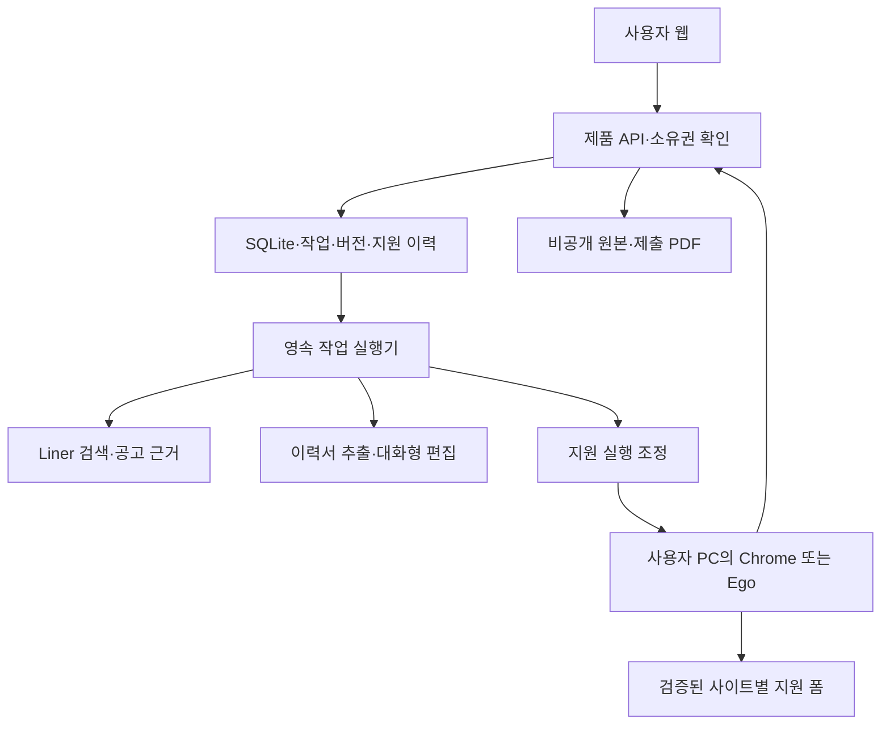

# Career Evidence 통합 기술 구조 v0.7

기준일: 2026-11-16 (Asia/Seoul). 이 문서는 구현 목표다. 현재 실행 코드는 v0.5에서 이어받은 기반이며, 구현 상태는 [PROGRESS](state/PROGRESS.md), 실행한 검사는 [VALIDATION](reports/VALIDATION.md)을 따른다. 제품 요구는 [PRODUCT_SPEC](PRODUCT_SPEC.md), 필드·HTTP·DB 계약은 [contracts/v0.7](../contracts/v0.7/README.md)이 현재 기준이다.

## 1. 구조와 책임

React·TypeScript 웹, Node·TypeScript API와 영속 worker, SQLite를 유지한다. 기존 저장소 구조를 바꾸는 프레임워크 이관은 첫 개발 과업에 포함하지 않는다. 파일 원본·생성 PDF는 비공개 파일 저장소에 보관하고 DB는 소유 범위·버전·hash·상태를 관리한다.

| 구성 | 입력과 결과 | 최초 구현 위치 |
| --- | --- | --- |
| 웹 | 원본 등록·확인·공고 선택·대화·diff·지원 상태 | `apps/web/src/` |
| API | 인증된 principal과 workspace 확인, 입력 검증, 버전 고정, 작업 저장 | `apps/api/src/` |
| 작업 실행기 | DB에서 작업 claim, lease 유지, 외부 호출, CAS로 결과 저장 | `apps/worker/src/` |
| 도메인 | 사실과 조건 구분, 수정안 검증, 정책 적격성, 제출 권한 결속 | `packages/domain/src/` |
| 검색 adapter | SearchIntent를 provider 요청으로 바꾸고 출처와 공고 snapshot 반환 | `packages/liner/src/` |
| 파일·추출·편집·렌더러 | 실제 원본 추출, 증거 위치, 수정안, PDF bytes | 현재 미구현. 단계 1·2에서 경로를 정하고 CODEMAP에 등록 |
| 브라우저 채널 | 정확한 계정·탭·문서·파일에 연결하여 입력·제출·관측 | `apps/extension/` 기반, Ego 로컬 연결은 후속 구현 |

서버와 worker 사이에 프로세스 메모리만으로 유지되는 작업 큐를 두지 않는다. 로컬 브라우저 채널의 연결 여부는 서버 작업 상태와 별도로 관리한다.

## 2. 이력서에서 검색까지

1. 원본 등록: 초기 형식은 텍스트가 추출되는 PDF와 텍스트 붙여넣기다. 입력 byte 제한·MIME·실제 파일 형식을 함께 확인한다. 스캔·암호화·손상 PDF는 실패 원인과 붙여넣기 대안을 제공한다. DOCX·OCR은 후속 지원 범위다.
2. 파일 저장: 실제 bytes로 hash를 계산한다. 사용자가 제공한 경로나 파일명을 저장 경로로 사용하지 않고 서버가 발급한 문서 ID로 관리한다. 파일명만으로 중복·권한을 판단하지 않는다.
3. 추출: 문서 페이지·문자 구간 또는 붙여넣기 구간을 보존한다. 추출 실패를 경력 없음으로 바꾸지 않는다. 원문과 파싱 결과를 분리한다.
4. 확인: 사용자 정정은 새 revision과 출처를 갖는다. 경력 사실, 연락처, 희망 조건을 구분한다. 검색에는 확인된 사실과 검색에 필요한 선호 조건을 사용한다.
5. 검색 계획: 직무·경력 수준·기술·업무 영역으로 SearchIntent를 만들고 기반 경력 revision을 고정한다. 연락처·생년월일 등 공고 탐색에 불필요한 값은 질의에서 제외한다.
6. 작업 저장: 검색 계획과 idempotency를 저장한 뒤 worker가 처리한다. 새로고침·프로세스 재시작 후 같은 결과를 조회할 수 있어야 한다.
7. 결과: 검색 출처·확인 시점·공고 원문·추천 근거를 연결한다. 미확인은 조건 미충족과 별도로 표시한다. 공고 마감·지원 URL·회사 identity는 제출 전에 다시 확인한다.

목 구현도 업로드→추출→사용자 확인→검색 계획 경로를 거친다. `fixtures/resumes/`의 두 합성 이력서는 서로 다른 검색 계획을 만드는 검증 입력이다. 현재 고정 `React` 질의와 고정 3개 후보는 기반 진단 예제이며 단계 1에서 제품 경로를 새로 연결한다.

## 3. Liner와 편집 모델의 역할

Liner Search API는 제목·설명·URL·날짜 등을 포함한 구조화 검색 결과를 제공한다. Search Agent는 답변과 출처를 SSE로 제공하고, Deep Research는 심층 조사 용도다.[1][2][3] 우리 서비스는 이 출력을 공고의 권위 있는 사실로 즉시 확정하지 않고 source·fact·judgment로 정규화한다.

| 기능 | 설계한 사용 방식 |
| --- | --- |
| 공고 탐색 | SearchIntent를 검색 질의로 만들어 Liner Search에 전달 |
| 공고 요구사항·기업 근거 확인 | 필요한 공고에 한해 Search Agent 또는 근거 수집 경로 사용 |
| 기업 심층 브리프 | 선택 기능. 이력서 편집이나 지원 전에 매번 실행할 필수 단계가 아님 |
| 대화형 이력서 편집 | 별도 `ResumeEditor` 인터페이스. 확인된 경력·공고·대화·현재 revision에서 수정안 생성 |

`ResumeEditor`의 실제 모델·API는 단계 2에서 품질·구조화 출력·비용·데이터 전송 조건을 확인해 정한다. Liner Router 등 선택 가능 경로를 조사할 수 있지만, 문서에 이름이 있다는 이유로 이미 통합된 것으로 표시하지 않는다. 초기 개발은 결정적인 mock editor로 상태·수정안 수용·충돌·파일 생성을 먼저 연결할 수 있다. mock의 scripted 응답은 AI 품질 검증으로 보고하지 않는다.

Claude Code는 이 제품을 구현하는 개발 도구다. 사용자용 대화 기능에는 실제 런타임 provider 연결이 별도로 필요하다. 기존 Claude Code 사용 권한이 제품 사용자의 API 호출까지 포함한다고 가정하지 않는다.

외부 유료 호출은 요청 전 예산 예약, 호출 ID, 전송 상태, 결과·비용의 확인 상태를 기록한다. 전송 여부가 불명확한 호출을 worker 재시작으로 자동 재전송하지 않는다. 가격은 코드에 현재 사실로 고정하지 않고 사용 시점 공식 문서와 계정 설정을 확인한다. 초기 검색 건수의 허용 범위는 v0.7 계약을 따른다. 상한을 늘릴 때는 API·Schema·DB·UI를 함께 변경하고 검증하며, provider가 허용하는 결과 수와 제품 상한을 혼동하지 않는다.

## 4. 대화와 문서 revision

원본 문서, 확인된 경력, 공고별 이력서, 렌더링한 파일은 각각 식별자와 버전을 가진다. AI 수정안은 기준 revision과 변경 구간, 사용한 사실 ID, 새로 확인해야 할 사실을 포함한다. 수동 대화 편집에서는 사용자가 수용한 변경을 새 문서 revision에 반영한다. 정책이 허용한 자동 편집은 매건 수동 확인 없이 revision을 생성할 수 있으며, 적용한 정책과 검사 근거를 수동 수용과 구분해 기록한다. 오래된 응답은 새 버전을 덮지 않는다.

새로운 성과 수치·기술·역할은 기존 원문 또는 명시적으로 확인한 사용자 진술이 필요하다. 문장을 자연스럽게 바꾸는 작업은 새 사실을 추가한 것으로 취급하지 않는다. AI가 이미 만든 문장을 다음 편집에서 독립 증거로 재사용하지 않는다.

PDF 생성은 별도 영속 작업이다. 상태 완료는 파일이 실제로 존재하고 bytes hash·파일 크기·내용 revision이 일치할 때만 기록한다. PDF 미리보기·다운로드·지원 첨부는 같은 rendered artifact를 사용한다. 이력서가 바뀌면 새 PDF를 생성하며 기존 제출 파일을 덮어쓰지 않는다. 최초 렌더러 선택은 한글 글꼴·문장 줄바꿈·텍스트 추출·다중 페이지 출력을 확인하고 기록한다.

## 5. 지원과 자동화

브라우저 실행은 [BROWSER_ADAPTERS](BROWSER_ADAPTERS.md)를 따른다. `executor`는 Chrome/Ego 같은 실행 채널, `site adapter`는 특정 사이트의 폼 인식·필드 매핑·완료 관측이다. 하나의 브라우저에 연결되었다고 모든 채용사이트를 지원하는 것은 아니다.

수동 지원은 사용자가 확인한 공고·서류·답변·계정에 결속한다. 자동 지원은 사용자가 활성화한 정책에서 공고마다 별도의 실행 권한을 만든다. 정책 범위 내에서는 매건 수동 확인 없이 제출할 수 있으며, 실제 사용자 검토가 없던 건을 수동 검토 완료로 표시하지 않는다.

자동 지원 정책에는 고정 기준 공고, 확인된 경력 revision, 허용된 문서 수정 방식, 사이트·계정·직무·근무 조건, 제외 회사, 일일·전체 한도, 만료, 비용 한도를 연결한다. 한도 예약과 전송 직전의 정책 활성 여부 확인은 원자적으로 처리한다. 문서·문항·공고·계정·정책이 바뀌면 미전송 권한을 다시 평가한다.

외부 전송을 시작한 후 결과가 불명확하면 접수 확인 대기 상태와 중복 방지 점유를 유지한다. 브라우저가 바뀌거나 worker가 재시작되어도 같은 공고를 자동 재제출하지 않는다. 한도·비용 예약도 성공하지 않았다는 추측으로 즉시 환원하지 않는다. 중지 요청은 새 전송을 중단하며 이미 전송된 외부 효과를 되돌린 것으로 보고하지 않는다.

지원 접수 상태와 채용 진행 상태는 다른 필드와 이력을 가진다. HTTP 오류·접수 거절을 채용 불합격으로 기록하지 않는다. 지원 기록을 사용자 수동 입력으로 보완할 수 있고, 이 기록도 중복 판정에 활용한다. 이메일 연동은 필수가 아닌 후속 선택 기능이다.

## 6. 소유권·문서 보관·외부 콘텐츠

실제 이력서를 다루는 경로는 서버에서 확인한 principal과 workspace membership을 요구한다. 요청 body의 owner ID나 브라우저가 주장하는 workspace만으로 권한을 주지 않는다. 문서 원본·대화·추출·파일 다운로드·지원 이력 모두 같은 소유권 확인을 거친다. 개발 합성 세션은 실제 계정 인증의 완료 증거가 아니다.

원본 파일은 공개 웹 디렉터리 밖에 둔다. 원본 경력·연락처·키·브라우저 쿠키는 일반 로그와 fixture에 남기지 않는다. 외부 모델에 어떤 내용을 보내는지 제품에서 설명하고, 공고 검색에는 필요한 직무 신호만 전달한다. 이력서 삭제·캠페인 중지는 제품 작업 상태에 반영하되, 이미 외부 회사에 제출한 자료가 회수되었다고 표시하지 않는다.

공고·PDF·브라우저 페이지의 문장은 분석할 데이터다. 그 안의 명령으로 계정·정책·파일 접근 범위나 제출 대상을 변경하지 않는다. 사용자 설정과 서버의 실행 계약이 우선한다. 파일·브라우저 작업은 허용된 타입·대상·동작으로 제한한다.

## 7. DB 전환과 현재 코드의 경계

`contracts/v0.4/`는 byte 단위로 보존한 과거 계약이다. 현재 `packages/db/src/index.ts`는 v0.4의 17개 제품 테이블과 metadata를 초기화하고 정의 변경을 감지한다. 새로운 계약은 `contracts/v0.7/`의 `ce7_*` 추가 구조다.

단계 1에서는 baseline hash·현재 DB 버전 확인→새 schema 적용→migration 기록과 객체 digest 갱신→재시작 검증을 수행하는 migration runner와 runtime 변경을 함께 구현해야 한다. SQL만 기존 DB에 적용하면 기존 객체 변경 검사에 걸릴 수 있다. 테스트는 임시 DB에서 수행하고 사용자 DB 자동 삭제·reset으로 해결하지 않는다. 이전 synthetic 데이터는 실제 이력서 소유권이나 사용자 경력으로 자동 승격하지 않는다.

새 계약의 JSON Schema·OpenAPI·SQL 검사는 설계 일관성을 확인한다. API handler·브라우저·모델·PDF 렌더러가 구현됐다는 뜻이 아니다. 제품 인수 기준은 [ACCEPTANCE](ACCEPTANCE.md)의 실제 실행으로 별도 확인한다.

## 참고

[1] https://liner.com/developers/docs/search-api

[2] https://liner.com/developers/docs/search-agent-api

[3] https://liner.com/developers/docs/deep-research-agent-api

도구 문서는 2026-11-16에 확인했다. 위 구조·상태·권한 정책은 Career Evidence의 설계 결정이며 provider 보장으로 해석하지 않는다. 전체 출처는 [SOURCES](SOURCES.md)에 모았다.
